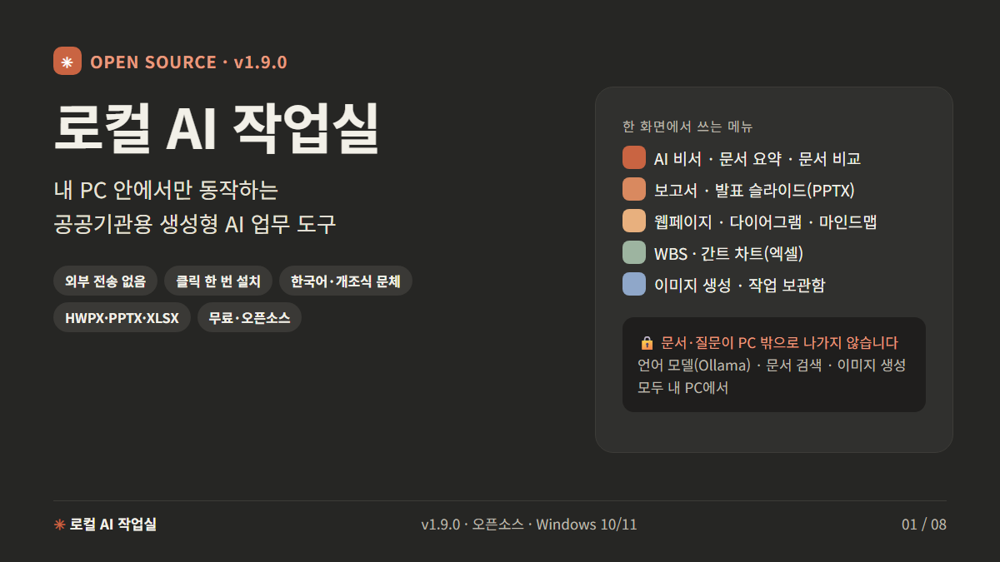
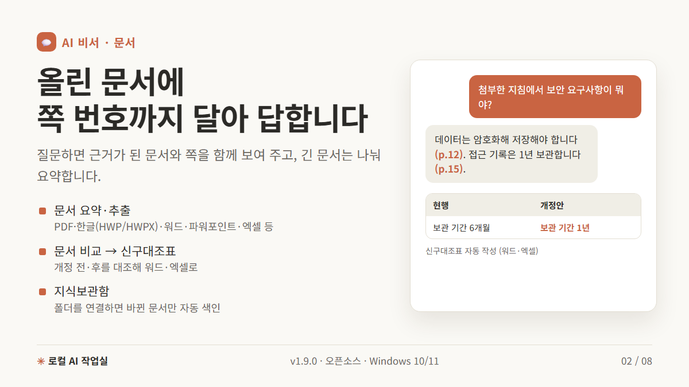
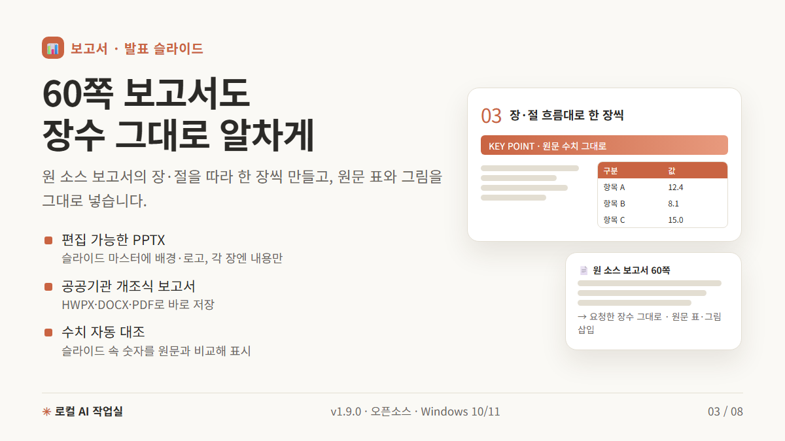
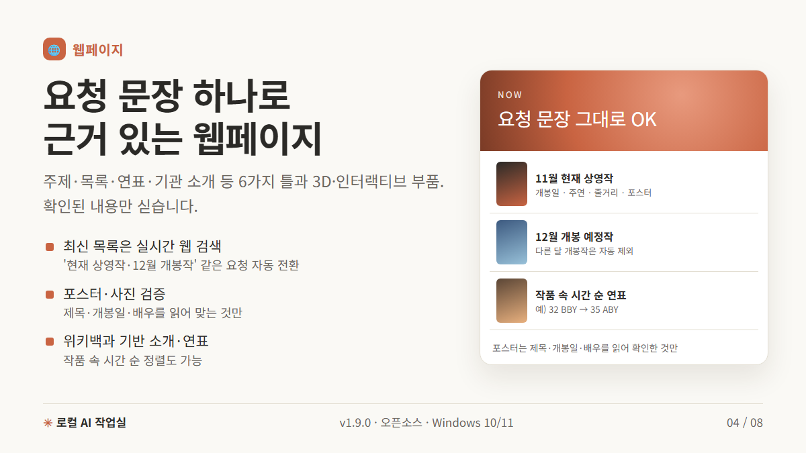
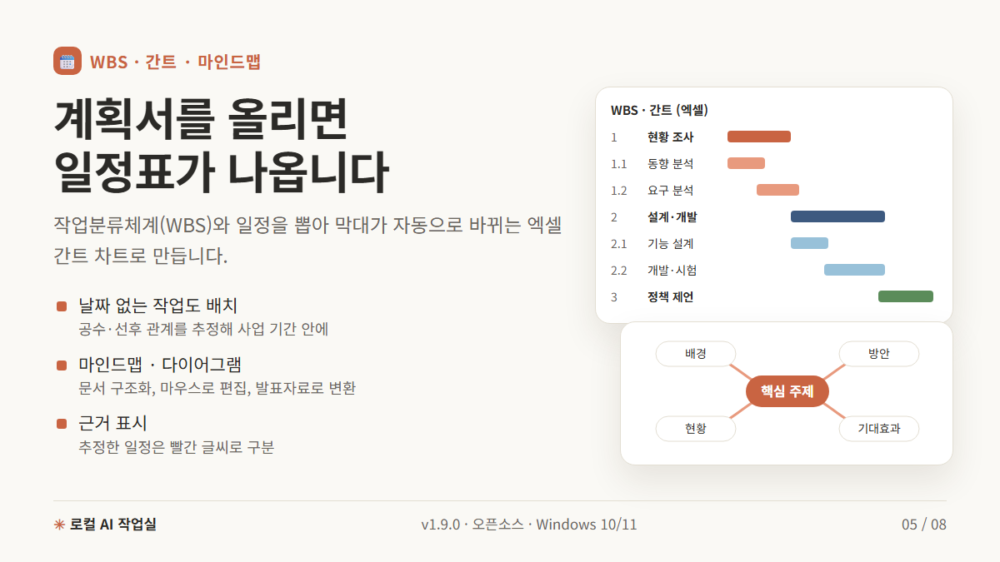
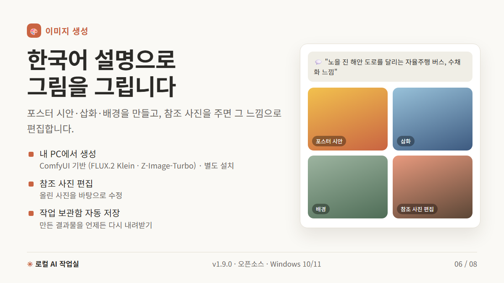
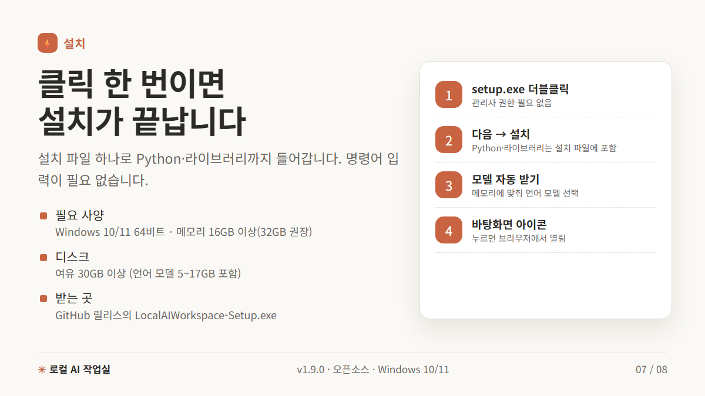
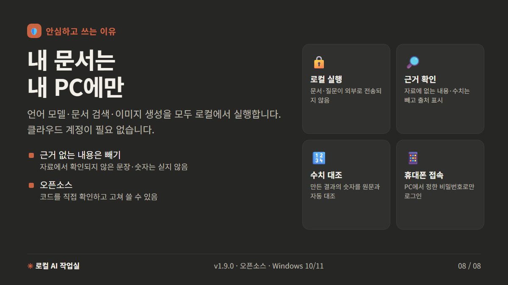

# 로컬 AI 작업실

외부 클라우드 없이 PC·서버 한 대에서 동작하는 공공기관용 생성형 AI 업무 도구입니다.
문서·질문이 밖으로 나가지 않도록 언어 모델(Ollama), 문서 검색(CPU 임베딩), 이미지 생성(ComfyUI)을 모두 로컬에서 실행합니다.
Docker·WSL 없이 네이티브 Python 가상환경으로 설치됩니다.

## 기능

| 메뉴 | 하는 일 |
|---|---|
| AI 비서 | 말로 요청하면 알맞은 기능을 실행. 첨부 문서에 쪽 번호를 달아 답하고, 여러 작업을 한 번에 처리 |
| 문서 요약·추출 | 긴 문서 분할 요약, PDF 그림·표 추출 정리 |
| 문서 비교 | 개정 전·후 문서를 대조해 신구대조표(워드·엑셀) 작성, 주요 변경 요약 |
| 지식보관함 | 폴더를 연결하면 바뀐 문서만 자동 색인(구글 드라이브 동기화 폴더 포함), 출처·쪽 번호와 함께 답변 |
| 보고서·기안문 | 공공기관 개조식 문체로 초안 작성 (HWPX·DOCX·PDF) |
| 발표 슬라이드 | 모던·블루 디자인 테마(슬라이드 마스터), 내 PPTX·PDF 템플릿, 원 소스 보고서를 장·절대로 배분해 원문 표·그림 삽입 |
| 웹페이지 | 6가지 틀 + 3D·인터랙티브 부품. 위키백과·실시간 웹 검색 자료로 근거 있는 내용만, 최신 목록(상영작 등)은 자동으로 웹 검색 |
| 다이어그램 | draw.io 도형으로 그리고 마우스로 편집 |
| 마인드맵 | 직접 작성·문서 구조화·AI 가지 펼치기, 발표자료·웹페이지로 변환 |
| WBS·간트 차트 | 계획서에서 WBS·일정 추출 → 막대가 자동으로 바뀌는 엑셀 |
| 이미지 생성 | 한국어 설명·참조 사진으로 그림 생성 (FLUX.2 Klein, Z-Image-Turbo) |
| 작업 보관함 | 모든 결과물 자동 저장, 다시 내려받기 |

| | |
|---|---|
|  |  |
|  |  |
|  |  |

소개 카드(1200×675)는 `docs/cards/` 에 있고, `python packaging/make_intro_cards.py` 로 다시 만들 수 있습니다.

## 설치

- **개인 PC (Windows 10/11) — 클릭 한 번 설치**: [릴리스](../../releases/latest)에서 `LocalAIWorkspace-Setup-<버전>.exe` 를 받아 더블클릭
  - 관리자 권한 필요 없음. Python·라이브러리는 설치 파일에 들어 있고, 설치 중 Ollama와 언어 모델(메모리에 맞춰 5～17GB)만 인터넷으로 받습니다.
  - 필요: 메모리 16GB 이상(32GB 권장), 디스크 여유 30GB 이상. 언어 모델을 받는 데 수십 분 걸릴 수 있습니다.
  - "Windows의 PC 보호" 창이 뜨면 **추가 정보 → 실행** 을 누르세요(코드 서명 인증서가 없는 무료 배포 파일이라 뜨는 경고입니다).
  - 설치 후 바탕화면 **'로컬 AI 작업실'** 아이콘을 누르면 브라우저에서 열립니다. 끄기·다시 설치·제거는 시작 메뉴 '로컬 AI 작업실' 폴더에 있습니다.
  - 설치 파일 만들기: `python packaging/build_desktop_installer.py` → `dist/` (Inno Setup 6 필요)
- **개발용 실행**: `start_workspace.bat` (Python 3.12 가상환경 `.venv`, Ollama 필요)
- **서버 (리눅스·Windows Server)**: [packaging/docs/INSTALL.md](packaging/docs/INSTALL.md)
  - 설치 패키지 만들기: `python packaging/build_packages.py` → `dist/`
- 사용법: [사용_가이드.md](사용_가이드.md)
- 개발 과정에서 겪은 문제와 해결법: [packaging/docs/개발_이력_및_노하우.md](packaging/docs/개발_이력_및_노하우.md)

## 저장소에 없는 것

용량이 크거나 개인·업무 자료라서 올리지 않습니다 (`.gitignore`).

- Python 가상환경 `.venv`, 언어 모델(Ollama가 받음), ComfyUI 와 이미지 모델 (`imagegen/setup_comfyui.ps1`, `download_models.ps1` 로 설치)
- 작업 보관함 `outputs/`, 지식보관함 `chroma_db/`, 업로드한 양식 `templates/`, 이미지 생성 결과·참조 사진

## 라이선스 참고

- 아이콘: Lucide(ISC), Tabler·Phosphor·Bootstrap Icons·Heroicons(MIT) — [icons/LICENSES.md](icons/LICENSES.md)
- 슬라이드 테마는 로고·배경 그림 없이 도형과 색만으로 그립니다. 필요하면 `slide_themes/modern/` 에 `bg-dark.jpg`(배경)나 `logo-gray.png`·`logo-white.png`(로고)를 넣으면 자동으로 쓰입니다.
